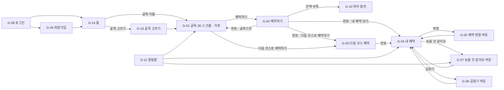
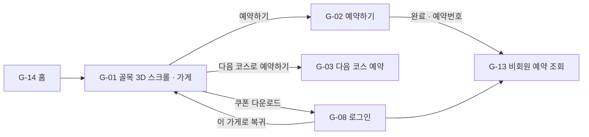
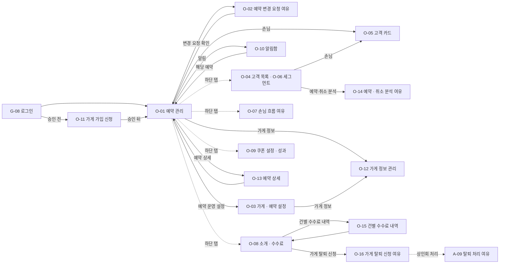
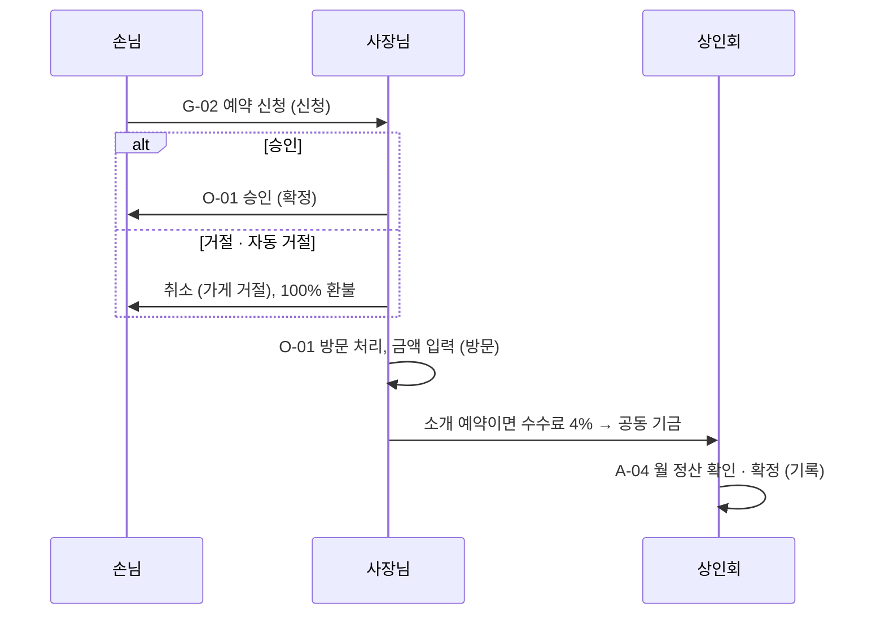
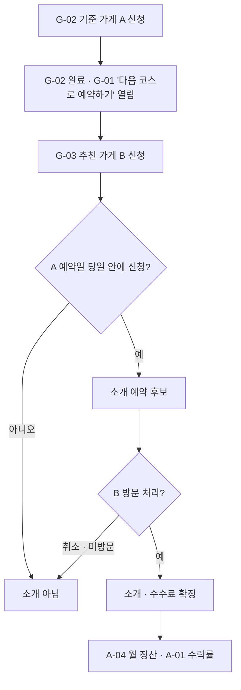
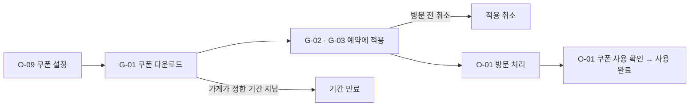
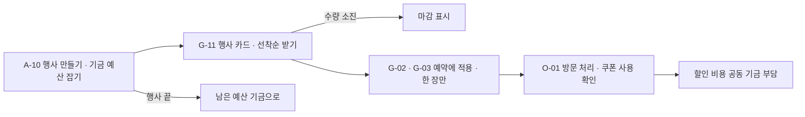
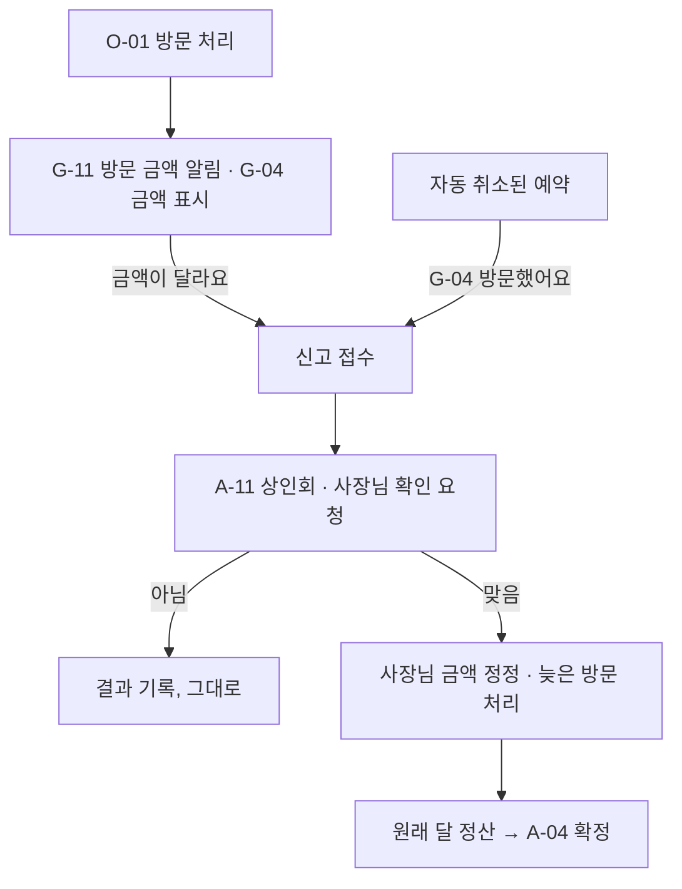

# 사용자 흐름

> 상태: 초안 (2026-11-24). 손님 · 사장님 · 상인회가 화면을 어떤 순서로 지나가는지 잇는다.
> 이 문서는 [`07-screens.md`](07-screens.md)의 '이동' 열을 이어 붙인 것이다. 화면마다 꼭 있어야 할 것은 07-screens, 규칙과 숫자는 [`05-policy.md`](05-policy.md)에 있고, 이 문서는 링크만 건다.
> 07-screens에 없는 이동은 만들지 않았다. 이동이 비거나 서로 맞지 않는 곳은 맨 아래 「맞지 않는 곳」에 모았다.

## 읽는 법

- 화면 ID는 07-screens를 따른다. 손님 `G-`, 사장님 `O-`, 상인회 `A-`.
- 괄호 안은 근거 요구사항 ID다.
- (여유)는 07-screens에서 여유로 표시한 화면 · 요소다.
- 예약 상태는 신청 · 확정 · 방문 · 취소 4개만 쓴다(FR-RSV-02).

## 손님

### 회원

손님 하단 탭은 홈(G-14) / 내 예약(G-04) / 마이(G-10)이고, 알림(G-11)은 위쪽 종 아이콘이다. 내 쿠폰 · 알림함 · 활동 기록(G-16, 여유) · 정책(G-12)은 마이 안에서 들어간다(07-screens 「메뉴 (하단 탭)」, 11-24 (4)).

1. G-08 로그인 → G-14 홈(FR-AUTH-01 · 05). 회원가입은 G-08에서 G-09로 들어가고, 가입 뒤 G-14로 간다(FR-AUTH-02).
2. G-14에서 동네 그림의 골목 이름을 누르면 그 골목의 G-01로 바로 들어가고, '골목 고르기'를 누르면 G-15에서 골목(정문 앞 · 중앙 · 뒷길)을 고른 뒤 G-01로 들어간다(FR-MAP-01).
3. (여유) G-14의 오늘의 코스를 누르면 첫 가게를 기준 가게로 고른 G-01이 열린다(FR-CRS-13).
4. G-01 골목 안을 스크롤로 걸으며 가게를 누르면 가게가 확대되고, '다음에 많이 찾은 곳 3곳'과 예약하기 바가 뜬다(FR-MAP-01, FR-CRS-01).
5. 추천 카드에 '예약 혜택' 배지가 있으면 '쿠폰 다운로드'를 누를 수 있다(FR-CPN-02 · 03).
6. 예약하기 → G-02 예약하기. 일시 · 인원, 공유 동의, 예약금, 쿠폰 선택(기본 '적용 안 함', 회원이 직접 고름)(FR-RSV-01 · 08, FR-CUS-01, FR-CPN-06).
   - 잔액이 예약금보다 적으면 신청이 거절되고 G-10 충전으로 간다(FR-RSV-08).
7. 완료하면 상태 '신청'. 완료 화면에 다음 코스 추천 3곳이 뜬다. '다음 코스로 예약하기' → G-03, '…골목에서 보기' → 그 골목의 G-01, '내 예약 보기' → G-04, '골목으로 돌아가기' → G-01(FR-RSV-11).
8. G-03 다음 코스 예약. 같은 날은 기준 가게 예약 시각보다 늦은 시간만, 다른 날짜는 모든 시간을 고를 수 있고, 어기면 거절된다(FR-RSV-11, 11-26 (2)). G-01 추천 카드의 '다음 코스로 예약하기'로도 들어간다.
9. 완료 → '내 예약 보기' → G-04. 다음 코스 예약은 기준 가게 예약과 묶여 시간순 코스로 보인다(FR-RSV-12).
10. G-04에서 변경 → G-05 (여유), 길찾기 → G-06 (여유), '늦을 것 같아요' → G-07 (여유). G-05 · G-06 · G-07은 끝나면 G-04로 돌아온다.
11. G-11 알림함: 리마인드 → G-07, 예약 알림 → G-04, 추천 알림 → G-01, 쿠폰 알림 → 쿠폰 상세(FR-NTF-03, FR-CRS-02).

### 비회원

1. 로그인 없이 G-14 홈에서 시작한다(G-08 '비회원으로 둘러보기'도 G-14로 간다). G-01까지는 회원과 같다.
2. 예약하기 → G-02. 이름 · 전화번호(필수), 성별 · 연령대(선택)를 넣는다. 쿠폰 없이 진행한다(FR-RSV-01, FR-AUTH-03, FR-CPN-06).
3. 완료 화면에 상태 '신청'과 **예약번호**가 뜬다(FR-AUTH-03).
4. 다음 코스 예약(G-03)은 회원과 같다. G-03의 '로그인하고 쿠폰 쓰기'를 누르면 G-08로 간다.
5. 예약 확인 · 변경 · 취소 · 알림은 G-04 대신 G-13 비회원 예약 조회에서 한다. 예약번호 + 전화번호로 들어간다(FR-AUTH-03, FR-NTF-02). G-13은 G-08과 G-02 완료 화면('내 예약 보기')에서 들어간다.
6. 쿠폰 다운로드를 누르면 G-08로 갔다가 로그인 뒤 그 가게로 돌아온다(FR-CPN-03).

## 사장님

1. G-08 로그인 → O-01 예약 관리. 가게 승인 전이면 O-11 가게 가입 신청으로 가고, 다른 메뉴는 잠긴다(FR-AUTH-04, FR-STO-01).
   - 가게 가입 신청은 G-09에서 손님 회원가입과 나뉘어 들어간다(FR-STO-01).
2. O-01에서 새 예약을 새로 고침 없이 받는다(FR-NTF-01, NFR-05).
3. '신청' 예약을 승인(→ 확정) 또는 거절(→ 취소, 사유 '가게 거절')한다(FR-RSV-03).
4. 확정 예약을 방문 처리한다. 결제 금액(할인 전)을 넣으면 소개 여부와 수수료가 결과에 나온다(FR-RSV-09, FR-STL-02).
5. 쿠폰 적용 예약은 방문 처리와 따로 '쿠폰 사용 확인'을 누른다(FR-CPN-08).
6. O-01에서 손님 → O-05 고객 카드, '변경 요청 확인' → O-02 (여유, '오늘 예약으로 돌아가기'로 O-01 복귀), '예약 운영 설정' → O-03, '손님 흐름 보기' → O-07. 위쪽 알림 아이콘 → O-10. O-10의 알림은 O-01 해당 예약(변경 요청은 O-02, 손님 흐름은 O-07, 정산은 O-08)으로 간다.
7. 하단 탭은 예약(O-01) / 고객(O-04 · O-06) / 손님 흐름(O-07, 여유) / 소개·정산(O-08) / 쿠폰(O-09)이다(11-24 (4)). 운영 설정(O-03) · 변경 요청(O-02)은 예약 안에서 들어간다.
8. 고객 탭: O-04 고객 목록과 O-06 세그먼트 분석은 한 화면의 두 탭이다. O-04에서 손님 → O-05, (여유) '예약·취소 분석' → O-14(FR-ANL-07).
9. O-01의 '가게 정보' 또는 O-03에서 O-12 가게 정보 관리로 들어가 영업시간 · 휴무일 등을 고친다(FR-STO-02, 11-24 (5)). O-01 예약의 '예약 상세 ›' → O-13 예약 상세, O-13에서 '오늘 예약에서 방문 처리하기' → O-01.
10. 소개·정산 탭 O-08에서 '건별 수수료 내역' → O-15(FR-STL-03), (여유) '가게 탈퇴 신청' → O-16(FR-STO-03). O-15에서 '월 정산으로 돌아가기' → O-08.
11. (여유) 탈퇴 흐름: 사장님이 O-16에서 탈퇴를 신청하면, 상인회가 A-09에서 미정산(확정 안 된 달)을 확인한 뒤 처리한다(FR-STO-03, 11-24 (5)).

## 상인회

1. G-08 로그인 → A-01 대시보드(FR-AUTH-01).
2. A-01: 코스 제안 수락률, 재방문율, 소개 수수료 총액(FR-ANL-06).
3. 하단 탭은 대시보드(A-01) / 가게 성과(A-02) / 방문 흐름(A-03) / 정산(A-04)이다(11-24 (4)). A-01의 '방문 흐름 보기' → A-03, '월 정산 보기' → A-04.
4. A-02 가게 성과 비교(FR-ANL-04). A-03 방문 흐름: 전체 연결선, 선 굵기 = 확인된 연계 방문 수, 인기 연결 TOP 3(FR-ANL-03, 11-24 (4)).
5. A-04 공동 기금 · 정산: 월 정산을 확인 · 확정한다(FR-STL-05). 규칙은 05-policy 「정산」. '공동 기금 적립 내역' → A-07, A-07에서 '월 정산으로 돌아가기' → A-04(FR-STL-05 · 06, 11-24 (5)).
6. A-05 가게 관리는 A-02 안 '가게 관리'에서 들어간다: 가입 신청 승인 · 거절, 참여 가게 목록(FR-STO-01 · 02). (여유) '미정산 확인 후 탈퇴 처리' → A-09 탈퇴 처리, '공유 항목 설정' → A-08 정보 공유 설정(FR-STO-03, FR-CUS-06, 11-24 (5)). A-09에서 미정산이 남아 있으면 '정산 확정하러 가기' → A-04.
7. (여유) A-06 데스크톱 대시보드: '방문 흐름 자세히' → A-03, '공동 기금·월 정산' → A-04.
8. A-10 상인회 쿠폰 관리 · A-11 신고 처리(번호 · 진입 위치 임시, 11-25 (5)). 흐름은 아래 「상인회 쿠폰 흐름」 · 「방문 금액 확인 · 신고 흐름」.

노드가 적어 그림은 생략한다.

## 역할을 넘는 흐름

### 예약 한 건의 일생

상태와 예약금 · 쿠폰 처리는 05-policy 「상태와 전이」 표를 따른다.

1. 손님이 G-02(또는 G-03)에서 신청 → **신청**. 사장님 O-01 · O-10에 새 예약 알림(FR-NTF-01).
2. 사장님이 O-01에서
   - 승인 → **확정**. 손님 G-11에 확정 알림(FR-NTF-03).
   - 거절 → **취소**(가게 거절), 예약금 100% 환불.
   - 예약 시각까지 승인 없음 → 자동 거절, **취소**(가게 거절), 100% 환불(NFR-06).
3. 손님은 신청 · 확정 상태에서 G-04 · G-13으로 취소할 수 있다. 환불은 05-policy 「취소와 환불」.
4. (여유) 확정 예약을 G-05에서 바꾸면 다시 **신청**이 되고 O-02에서 재승인한다. 거절되거나 기한까지 승인이 없으면 원래 예약이 유지된다. 변경은 가게 취소 마감 전까지만 신청할 수 있고, 인원이 바뀌면 승인할 때 예약금 차액을 정산한다(FR-RSV-07, 11-27).
5. (여유) 다음 예약 30분 전 리마인드 → G-07 지연 입력 → 사장님 O-01 · O-10에 표시(FR-RSV-10).
6. 사장님이 O-01에서 방문 처리(결제 금액 입력) → **방문**(FR-RSV-09).
   - 예약일 다음 날까지 방문 처리도 취소도 없으면 자동 취소, **취소**(자동 취소), 환불 없음.
7. 이 예약이 소개 예약이면 방문 처리 시점에 수수료가 확정되고, 받은 가게 가상 잔액에서 상인회 공동 기금으로 옮겨진다(FR-STL-02). 가게 잔액이 모자라도 방문 처리는 막지 않고 잔액이 마이너스가 될 수 있으며, 사장님은 O-08에서 가상 충전한다(FR-STL-06, 11-25 (4)). 사장님은 O-08에서 내역을 본다(FR-STL-03).
8. 상인회는 A-04에서 방문 처리된 달 기준 월 정산을 확인 · 확정한다. 확정은 확인했다는 기록이고 잔액을 바꾸지 않는다(FR-STL-05, 11-24).

### 코스 예약 · 소개 흐름

규칙은 05-policy 「가게 재량과 운영」의 코스 예약, 「소개 판정」을 따른다.

1. 손님이 기준 가게(A)를 G-02에서 신청한다. 승인 전이라도 G-02 완료 화면과 G-01 추천 카드의 '다음 코스로 예약하기'가 열린다. 신청 전에는 잠기고 이유가 안내된다(FR-RSV-11).
2. 손님이 '다음 코스로 예약하기' → G-03에서 추천 가게(B)를 신청한다. 같은 날 A 예약 시각과 같거나 이르면 거절되고, A 예약이 취소 · 거절된 상태여도 거절된다(11-26 (2)).
3. B 예약을 **A 예약일 당일이 끝나기 전까지** 신청했으면 소개 예약 후보가 된다(FR-STL-01, 11-24 (2)). 일반 예약 · 쿠폰 다운로드 · 지도 노출은 소개가 아니다.
4. G-04에서 A · B 예약은 시간순 코스로 묶여 보인다(FR-RSV-12).
5. A가 취소 · 거절돼도 B 예약은 그대로이고, A에 '취소됨'이 표시된다. 거절이면 G-11로 알린다(FR-RSV-12, FR-NTF-03).
6. B 사장님이 O-01에서 B 방문을 처리하면 소개와 수수료가 확정된다. A는 보낸 실적에 들어가고 돈은 받지 않는다(FR-STL-02 · 04).
7. B 사장님 화면에는 '추천으로 왔어요' 여부만 보이고 보낸 가게 이름은 없다(FR-RSV-04, FR-CUS-05).
8. 확정된 소개는 A-01 코스 제안 수락률 분자에 들어간다(FR-ANL-06).

### 쿠폰 흐름

규칙은 05-policy 「추천 쿠폰」을 따른다. 쿠폰은 회원만 받는다.

1. 사장님이 O-09에서 쿠폰 행사를 만들고 기간(1 ~ 30일, 기본 7일) · 혜택 · 조건 · 총수량을 정한다(FR-CPN-01). 처음 확정한 뒤에는 어떤 값도 바꿀 수 없고 중단만 할 수 있다. 중단해도 이미 받은 쿠폰은 기한까지 쓸 수 있고, 중단한 뒤 행사를 새로 만들 수 있다(FR-CPN-11, 11-25).
2. 손님 G-01 추천 카드에 '예약 혜택' 배지가 뜨고, 회원이 '쿠폰 다운로드'를 누른다 → 다운로드됨(FR-CPN-02 · 03). 비회원은 G-08로 간다.
3. 다운로드 후 가게가 정한 기간 안에 G-02 · G-03에서 예약 신청에 적용한다 → 예약에 적용됨(FR-CPN-05 · 06). 기한이 지나면 기간 만료.
4. 예약이 방문 전에 취소되면 적용 취소된다.
5. 사장님이 O-01에서 방문 처리한 뒤, 따로 '쿠폰 사용 확인'을 누르면 사용 완료(FR-CPN-08).
6. 손님은 (여유) G-10 쿠폰함에서 상태를 본다(FR-CPN-09). 사장님은 (여유) O-09에서 쿠폰 지표를 본다(FR-ANL-09).

### 상인회 쿠폰 흐름

규칙은 05-policy 「상인회 쿠폰」을 따른다(11-25 (5)). 화면 A-10은 번호 · 배치가 임시다.

1. 상인회가 A-10에서 행사를 만든다: 혜택(정률이면 최대 할인액 필수) · 쓸 수 있는 가게(모든 참여 가게 또는 직접 고른 가게) · 수량 · 받을 수 있는 기간 · 유효기간(FR-CPN-12).
2. 만들 때 '수량 × 한 장 최대 할인액'이 공동 기금에서 예산으로 잡힌다. 잔액이 모자라면 만들 수 없다(FR-CPN-12).
3. 받을 수 있는 기간에 회원 G-11 알림함에 행사 카드가 뜨고, 회원이 '받기'를 누르면 선착순으로 1장 받는다. 수량이 다 나가면 카드는 남고 '마감'이 된다(FR-CPN-13). 비회원은 받을 수 없다.
4. 회원이 G-02 · G-03에서 쓸 수 있는 가게를 예약할 때 쿠폰을 직접 고른다. 가게 쿠폰과 같이 쓸 수 없고 한 장만 적용된다(FR-CPN-06 · 14).
5. 사장님이 O-01에서 방문 처리하고 따로 쿠폰 사용 확인을 한다(FR-CPN-08). 할인은 공동 기금이 부담한다(FR-CPN-14).
6. 쓸 수 있는 기간(유효기간)이 끝나면 쓰지 않은 예산이 기금으로 돌아온다(중단한 행사도 같다). 상인회는 확정 뒤 행사를 중단만 할 수 있고, 받은 쿠폰은 유효기간까지 쓴다(FR-CPN-12).

### 방문 금액 확인 · 신고 흐름

규칙은 05-policy 「방문 금액 확인 · 신고」를 따른다(11-25 (5)). 화면 A-11은 번호 · 배치가 임시이고, 사장님 쪽 정정 · 늦은 방문 처리 위치(O-13)도 임시다.

1. 사장님이 O-01에서 회원 예약을 방문 처리하면 G-11에 방문 금액 알림이 오고, G-04에도 같은 금액이 보인다(FR-STL-07).
2. 금액이 다르면 회원이 G-11 · G-04에서 '금액이 달라요'를 누른다. 다녀갔는데 자동 취소된 예약이면 G-04에서 '방문했어요'를 누른다. 그 달 월 정산 확정 전까지만 낼 수 있다(FR-STL-08).
3. 상인회가 A-11에서 신고를 받아 사장님에게 확인을 요청하고(O-10 알림), 결과(맞음 · 아님)를 기록한다(FR-STL-08).
4. '맞음'이면 사장님이 금액 신고는 금액 정정(수수료 차액 추가 거래), 미처리 신고는 늦은 방문 처리(자동 취소 → 방문)를 한다(FR-STL-09).
5. 차액과 늦은 방문 처리는 원래 방문(예약) 달 정산에 들어가고, 상인회가 A-04에서 그 달을 확정한다(FR-STL-05 · 09).

## 맞지 않는 곳

07-screens '이동' 열 기준으로 비었거나 서로 맞지 않는 곳. 추측으로 메우지 않았다.

| 위치 | 내용 |
| --- | --- |
| G-02 → G-10 충전 | 충전 뒤 G-02로 돌아오는 이동이 G-10에 없다. 확정 목업은 G-10에 가상 잔액을 보여주지만(11-24 (5)) 충전 뒤 돌아오는 이동은 없다. |
| G-01 '다음 코스로 예약하기' | 07-screens는 G-01 추천 카드에 이 버튼을 두지만(FR-RSV-11), 확정 목업의 골목 화면은 G-03으로 가지 않고 G-02 완료 화면에서만 G-03으로 간다. 문서에 있는 요소라 남겨 두었다. |
| O-01 '꼭 있어야 할 것' ↔ O-10 | 지연 입력은 O-01 표시와 O-10 알림 양쪽에 있다. 충돌은 아니지만 흐름상 중복이다. |
| A-10 · A-11 진입 | 11-25 (5) 화면은 번호 · 배치 · 진입 위치를 B가 정한다. 상인회 하단 탭 · 다른 화면에서 들어가는 이동이 아직 없다. |
