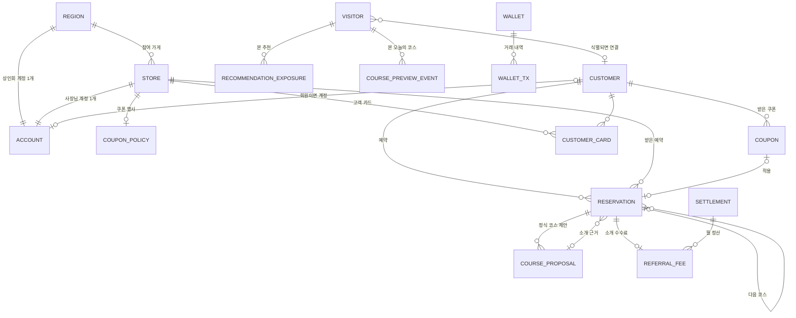

# 데이터 설계

> 상태: 초안 (2026-11-23). 기획 결정을 Entity · 관계 · 상태로 옮긴 것이다. 컬럼 이름과 타입은 개발 저장소의 계약 문서(`docs/CONTRACTS.md`)가 최종 기준이고, 이 문서는 그 출발점이다.
> 규칙과 숫자는 [`05-policy.md`](05-policy.md), 요구사항은 [`03-requirements.md`](03-requirements.md)를 따른다. 근거 기록: [11-23 (5)](reviews/decision-meeting-2026-11-23-5.md) · [11-24 (5)](reviews/decision-meeting-2026-11-24-5.md)(가게 정보 · 영업 상태 · 공유 항목) 외 `reviews/`.

## 한눈에

- 손님은 회원과 비회원을 한 `CUSTOMER`로 다룬다. 회원은 계정으로, 비회원은 전화번호로 식별한다(FR-CUS-02).
- 로그인 전 행동(가게 클릭 · 추천 노출)은 `VISITOR`(익명 방문자 ID)에 남기고, 식별되면 손님에 잇는다(11-23 (5)).
- 이동 · 같이 간 비율 · 세그먼트 · 지표는 원천 기록(예약 · 방문 처리 · 노출)에서 계산한다. 원천과 다른 값을 따로 저장하지 않는다.

## Entity

### 권역 · 가게 · 계정

**REGION (권역)**

| 필드 | 설명 |
| --- | --- |
| id, name | 권역. 시연은 대학가 골목 한 권역 |

**STORE (가게)** — FR-STO-01 · 02, FR-RSV-05 · 08

| 필드 | 설명 |
| --- | --- |
| id, region_id, name | 가게 이름은 가상 |
| category | 8개 업종 중 하나 |
| alley | 소속 골목(정문 앞 · 중앙 · 뒷길, 11-24 (4)) |
| map_x, map_y | 골목 안 표시 좌표 |
| real_lat, real_lng, real_verified | 실제 좌표(검증된 경우만). 검증 안 된 가게는 길찾기 대신 미리보기(FR-MAP-09) |
| join_status | 가입 신청 · 승인 · 거절 · 탈퇴 신청 · 탈퇴. 탈퇴 신청은 사장님이 신청하고 상인회가 처리하기 전 상태(11-24 (5)) |
| address | 주소. 상인회가 관리(11-24 (5)) |
| business_status, business_status_changed_at | 영업 · 휴업 · 중단과 바뀐 시각. 사장님이 바꾼다(11-24 (5)). 휴업 · 중단이면 추천 후보에서 빠지고, 그 가게 미사용 쿠폰은 적용 취소, 30일 제한은 해제(05-policy) |
| reservation_enabled | 예약 가능 여부(예약 받기: 받는 중 · 잠시 멈춤). 사장님이 바꾼다(11-24 (5)) |
| open_time, close_time | 영업 시작 · 종료 시각. 필수, 예약 가능 시간 계산 기준(FR-STO-02) |
| closed_days | 휴무일(요일, 연중무휴 가능). 필수, 예약 가능 시간 계산 기준(FR-STO-02) |
| intro | 한 줄 소개(여유) |
| menu_items | 대표 메뉴(여유) |
| amenities | 편의 정보, 여러 개 선택(여유) |
| seats | 좌석 수(여유) |
| photos | 가게 사진, 최대 3장(여유) |
| slot_minutes, capacity_per_slot, booking_window_days | 슬롯 단위, 동시에 받는 예약 수, 예약 가능 기간 |
| cancel_deadline_hours | 취소 마감(예약 시각 몇 시간 전). 24 이하로만 정할 수 있다(예약 시각 24시간 전보다 이르게 못 잡음) |
| deposit_per_person | 인원당 예약금. 0 가능 |
| max_party_size | 한 팀 최대 인원. 넘는 예약 신청은 거절(FR-RSV-05, 11-24 (5)) |
| late_cancel_refund_rate | 하루 전이 지난 뒤 취소의 환불 비율. 사장님이 정하고, 비어 있으면 권역 설정값(기본값)을 씀(FR-RSV-05 · 06, 11-24 (5)) |
| price_range | 가격대(예: 1인 9,000 ~ 12,000원)(여유, 11-24 (5)) |

**ACCOUNT (계정)** — FR-AUTH

| 필드 | 설명 |
| --- | --- |
| id, login_id, password_hash | |
| role | 손님(회원) · 사장님 · 상인회 |
| store_id | 사장님만. 가게당 1개 |
| region_id | 상인회만. 권역당 1개, 초기 데이터로 생성 |

### 손님 · 방문자 · 고객 카드

**CUSTOMER (손님)** — FR-AUTH-02 · 03, FR-CUS-02 · 07

| 필드 | 설명 |
| --- | --- |
| id, type | 회원 · 비회원 |
| account_id | 회원만 |
| name, phone | 비회원은 필수. 파기 대상 |
| gender, age_group | 회원은 회원정보, 비회원은 예약 화면의 선택 칸. 비어 있을 수 있음 |
| last_visit_at, last_cancel_at | 파기 시점 계산용 |
| purged_at | 비회원 파기 시각. 파기되면 이름 · 전화번호를 지우고 비식별 집계만 남김 |

**VISITOR (익명 방문자)** — 11-23 (5)

| 필드 | 설명 |
| --- | --- |
| id | 처음 들어올 때 브라우저에 두는 익명 ID |
| customer_id | 같은 브라우저에서 로그인하거나 비회원 예약을 하면 채움. 다른 기기는 연결 안 됨 |
| created_at, linked_at | |

**CUSTOMER_CARD (고객 카드)** — FR-CUS-03 · 04

| 필드 | 설명 |
| --- | --- |
| store_id, customer_id | 가게 × 손님. 상인회에는 없음 |
| visit_count, last_visit_at | 그 가게 방문 처리 기준. 등급은 이 두 값과 오늘 날짜로 계산(신규 · 일반 · 단골 · 이탈 위험) |
| memo | 사장님 메모. 비회원 파기 대상 |

**SHARE_CONSENT (공유 동의)** — FR-CUS-01

| 필드 | 설명 |
| --- | --- |
| reservation_id, consented_at | 예약마다 동의 기록 |
| items | 동의 시점에 공유된 항목 |

**SHARE_POLICY (공유 정책)** — FR-CUS-06

| 필드 | 설명 |
| --- | --- |
| region_id, item, enabled | 상인회가 항목별로 켜고 끔(인원 · 방문 일시 · 성별·연령대). 이름 · 연락처 · 방문한 가게 목록은 끌 수 없고 항상 켜짐(11-24 (5)) |

### 예약

**RESERVATION (예약)** — FR-RSV, 05-policy 「예약」

| 필드 | 설명 |
| --- | --- |
| id, reservation_no | 예약번호는 비회원 조회에 씀(FR-AUTH-03) |
| store_id, customer_id | |
| start_at, party_size | |
| status | 신청 · 확정 · 방문 · 취소 |
| cancel_reason | 손님 취소 · 가게 거절 · 자동 취소. 자동 거절은 '가게 거절' |
| requested_at | 손님 신청 시각. 소개 예약 신청 마감(기준 가게 예약일 당일 종료) · 쿠폰 7일 판단 기준 |
| confirmed_at, visited_at, canceled_at | |
| pending_start_at, pending_party_size | 변경 신청 중일 때 바꿀 값. 승인되면 반영, 거절 · 자동 거절이면 지움 |
| deposit_amount, refund_amount | 예약금과 환불액 |
| visit_amount | 방문 처리 때 사장님이 넣은 결제 금액(쿠폰 할인 전) |
| delay_eta | 지연 입력 도착 시간. 비회원 파기 대상 |
| course_root_id | '다음 코스로 예약하기'로 만든 예약만 기준 가게 예약 id를 가짐(11-23 (5)) |
| course_proposal_id | '다음 코스로 예약하기'로 기준 가게 예약일 당일이 끝나기 전에 신청한 경우, 사용한 정식 코스 제안 id. 기준 예약 id는 `course_root_id` |
| sender_store_id | 보낸 가게 = 제안을 만든 기준 예약(`course_root_id`)의 가게. 소개 후보가 아니면 비움(05-policy 「소개 판정」) |

- 소개 후보: `course_proposal_id`가 있으면 소개 후보다. 신청 시각에, 신청 당시 기준 예약일로 판정한다. 뒤에 기준 예약일이 바뀌어도 이미 신청한 예약의 판정은 바뀌지 않는다(11-24 (2)).
- 소개 확정: 소개 후보 예약이 방문 처리되면 예약 건당 한 번 확정한다. 기준 가게 예약이 취소 · 거절되거나 방문하지 않았어도 보낸 가게는 그대로 둔다.
- 지도 추천 · 오늘의 코스 노출, 일반 예약, 쿠폰은 `course_proposal_id`를 채우지 않는다.

### 추천 기록

**STORE_CLICK (가게 클릭)** — FR-CRS-07

| 필드 | 설명 |
| --- | --- |
| visitor_id, store_id, clicked_at | |

**RECOMMENDATION_EXPOSURE (추천 노출)** — FR-CRS-07

| 필드 | 설명 |
| --- | --- |
| id, visitor_id | 로그인 전에도 기록. 손님은 VISITOR를 거쳐 잇는다 |
| base_store_id, recommended_store_id | 기준 가게 · 추천 가게 |
| rank, page | 순위, 리롤 몇 번째인지 |
| badge, reason_type | '방문 데이터 기반' / '지역 인기 가게', 문구 종류 |
| shown_at | 노출 시각 |

지도 추천 노출 · 리롤은 탐색 기록이다. 소개 판정과 수락률에 쓰지 않는다(11-24 (2)).

**COURSE_PROPOSAL (정식 코스 제안)** — FR-STL-01, FR-ANL-06

| 필드 | 설명 |
| --- | --- |
| id | 제안 ID. 코스 예약의 `course_proposal_id`가 가리킨다 |
| base_reservation_id, recommended_store_id | 기준 예약 · 추천 가게. 이 조합당 1건(수락률 분모) |
| first_shown_at | 기준 가게 예약 신청 뒤 실제로 처음 표시한 시각. 리롤로 다시 표시돼도 새로 만들지 않음 |

**RECOMMENDATION_FEEDBACK (거절 · 리롤)** — FR-CRS-06

| 필드 | 설명 |
| --- | --- |
| exposure_id, type, created_at | 거절 · 리롤(사유는 받지 않음). 순위에는 쓰지 않음 |

**COURSE_PREVIEW_EVENT (오늘의 코스 노출 · 클릭)** — FR-CRS-07 · 11, 11-23 (8)

| 필드 | 설명 |
| --- | --- |
| visitor_id, type, created_at | 노출 · 클릭 |
| store_ids | 코스의 가게 3곳(순서대로) |
| day_type, time_band | 평일 · 주말, 시간대 구간 |

추천 노출(RECOMMENDATION_EXPOSURE)과 섞지 않는다. 탐색 기록이며 소개 판정과 수락률에 쓰지 않는다.

### 쿠폰

**COUPON_POLICY (쿠폰 행사)** — FR-CPN-01 · 11

| 필드 | 설명 |
| --- | --- |
| store_id, enabled | 참여 ON/OFF. 끄면 새 발급만 멈춤 |
| benefit_type | 정액 할인 · 서비스 제공 |
| discount_amount | 정액 할인 금액 |
| service_name, service_value | 서비스 내용과 환산 금액(쿠폰 비용 기록용) |
| conditions | 사장님이 정한 조건 |
| total_quantity, issued_count | 총수량과 발급 수. 동시 요청에도 넘지 않게 원자적으로 늘림(NFR-09) |

**COUPON (발급된 쿠폰)** — FR-CPN-03 ~ 10

| 필드 | 설명 |
| --- | --- |
| id, customer_id | 회원만 |
| target_store_id | 혜택을 주는 가게 |
| source_base_store_id, source_exposure_id | 받을 때의 추천 기준 가게와 추천 노출. 나중에 바뀌지 않음 |
| downloaded_at, expires_at | 만료 = 다운로드 + 7×24시간 |
| status | 다운로드됨 · 예약에 적용됨 · 사용 완료 · 기간 만료 · 적용 취소 |
| reservation_id | 적용된 예약 |
| discount_applied | 실제로 깎은 금액(정액은 방문 금액까지) |
| used_at | 사장님 사용 확인 시각 |

- 30일 제한은 같은 회원 · 같은 대상 가게의 가장 최근 `downloaded_at`으로 계산한다. 대상 가게가 휴업 · 중단 · 탈퇴하면 제한을 풀어야 하므로, 그 전에 받은 쿠폰은 계산에서 뺀다(STORE의 상태 변경 시각 기준).

### 가상 잔액 · 수수료 · 정산

**WALLET (가상 잔액)** — FR-STL-06

| 필드 | 설명 |
| --- | --- |
| id, owner_type, owner_id | 회원 손님 · 가게 · 상인회 기금. 비회원은 지갑이 없음 |
| balance | |

**WALLET_TX (거래 내역)** — FR-RSV-08, FR-STL-02

| 필드 | 설명 |
| --- | --- |
| id, wallet_id | 비회원 예약금은 지갑 없이 `guest_phone`으로 기록 |
| guest_phone | 비회원 가상 납부 · 환불 기록용 |
| type | 충전 · 예약금 납부 · 예약금 환불 · 소개 수수료 차감 · 기금 입금 |
| amount, reservation_id, created_at | |

**REFERRAL_FEE (소개 수수료)** — FR-STL-02 ~ 05

| 필드 | 설명 |
| --- | --- |
| reservation_id | 소개 예약. 방문 처리 때 생성 |
| receiving_store_id, sender_store_id | 낸 가게, 보낸 가게(제안을 만든 기준 예약의 가게) |
| visit_amount, coupon_discount, fee_base | 결제 금액, 쿠폰 할인, 수수료 계산 금액(할인 후) |
| fee_rate, fee_amount | 생성 시점의 수수료율과 금액 |
| coupon_cost | 쿠폰 비용(정액 할인액 또는 서비스 환산 금액). 수수료와 따로 기록 |
| settlement_month, settlement_id | 방문 처리된 달 |

**SETTLEMENT (월 정산)** — FR-STL-05

| 필드 | 설명 |
| --- | --- |
| id, region_id, month | |
| status, confirmed_at | 집계됨 · 확정 |

### 알림 · 설정 · 공공데이터

**NOTIFICATION (알림)** — FR-NTF

| 필드 | 설명 |
| --- | --- |
| id, recipient_type, recipient_id | 회원 계정, 사장님 계정, 또는 비회원 예약(비회원 예약 조회에서 봄) |
| type, payload, created_at, read_at | 예약 확정 · 변경 · 취소, 리마인드, 지연 입력, 다음 가게 추천, 쿠폰 상태 등 |

**SETTING (설정값)** — NFR-04

| 필드 | 설명 |
| --- | --- |
| region_id, key, value | 수수료율, 기간, 추천 가중치 등. 목록은 05-policy 「설정값」 |

**PUBLIC_STAT (공공데이터 통계)** — FR-CRS-04, NFR-10

| 필드 | 설명 |
| --- | --- |
| kind | 매력도 · CLQ · 시간대(요일 포함) · 성별·연령대 비중 |
| category_from, category_to, slot, gender, age_group, value | 업종 단위 값. 가게 단위가 아님 |
| source, period | 출처와 기준 기간(화면에 표시) |

## 데이터 출처 구분

외부 공개 통계 · 시연용 가상 데이터 · 실제 운영 데이터를 나눠 관리한다(NFR-10). 원천 기록(손님, 예약, 노출, 쿠폰, 거래)에는 출처 값을 두고, 화면에 시연 데이터임을 표시한다.

## 계산해서 보여주는 값

저장하지 않고 원천 기록에서 계산한다. 성능 때문에 미리 계산해 두더라도 원천에서 다시 만들 수 있어야 한다.

| 값 | 원천 | 정의 |
| --- | --- | --- |
| 이동 | RESERVATION(방문) | 같은 손님이 같은 날 연달아 방문 처리된 두 가게 |
| 같이 간 비율, 기대 대비 비율 | 이동, RESERVATION(방문) | 05-policy 「다음 방문 추천」 |
| 오늘의 코스 | RESERVATION(방문) | 같은 손님이 같은 날 이어서 방문 처리된 세 가게. 05-policy 「오늘의 코스」 |
| 손님 등급 | CUSTOMER_CARD | 05-policy 「손님 등급」 |
| 세그먼트 | RESERVATION(방문) | 손님이 이용한 전체 가게 중 특정 가게를 이용한 비율 |
| 수락 | COURSE_PROPOSAL, RESERVATION(소개 + 방문) | 정식 코스 제안 중 소개가 확정된 제안. 분모는 COURSE_PROPOSAL 건수, 0이면 표시하지 않음 |
| 수락률 · 재방문율 · 취소율 · 쿠폰 지표 | 위 기록들 | 03-requirements FR-ANL-06 · 07 · 09 |

## 가상 데이터 생성

같은 원천 데이터에서 순서대로 만든다(NFR-08). 앞 단계 결과만 보고 다음 단계를 만들고, 지표를 직접 만들어 넣지 않는다.

순서는 v1 결정 정리 「지표와 가상 데이터」의 생성 순서를 따른다.

1. 권역 · 가게 15곳 (업종 구성은 잠정, 공공데이터 참고)
2. 가상 손님 (회원 · 비회원, 성별 · 연령대. 손님 수는 미결)
3. 예약 (학기 중 9~11월, 실제와 비슷한 시간 분포, 금요일 저녁 주점 집중 패턴)
4. 일부 취소 (10% 안팎, 하루 전 취소 · 당일 취소, 사유 포함)
5. 방문 처리 (방문 금액 생성)
6. 같은 날 연속 방문 (20대 카페 → 디저트 패턴. 오늘의 코스가 보이도록 3곳 이어 방문도 포함)
7. 이동 통계
8. 추천 결과 (05-policy 「다음 방문 추천」 계산)
9. 추천 노출 · 정식 코스 제안 · 예약 전환 (제안 표시 시각은 기준 가게 예약 신청 뒤, 코스 예약 신청보다 앞서게 만들고, 방문자 ID를 붙임)
10. 소개 판정 · 수수료 · 월 정산
11. 대시보드 지표 계산 (코스 추천 이용자의 재방문율 패턴은 시뮬레이션임을 밝힘)

쿠폰 시연 사례(다운로드, 7일 만료, 30일 대기, 적용, 사용 완료, 다른 기준 가게에서 중복 차단)도 같은 원천에 포함한다.

## 남은 것

- 가상 손님 수 (NFR-07)
- 업종 구성 확정
- 컬럼 이름 · 타입 · 인덱스는 개발 저장소 계약 문서에서 정한다.
